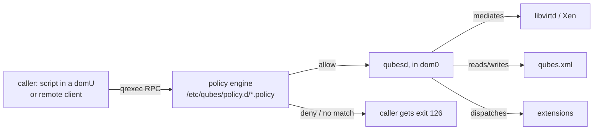

# Qubes Admin API

Internal reference for the Admin API — the supported management surface of
Qubes OS — and for using it to automate a Qubes host. Companion to
[../qubes-cli-tools/README.md](../qubes-cli-tools/README.md): the `qvm-*`
CLI tools are frontends over these calls; the API is what a *program*
(possibly running outside dom0) talks to.

Sources of truth (qubes-doc @ 37ae9d10, Qubes OS 4.3.2, current as of
2026-10-21):

- `developer/services/admin-api.rst` — canonical call table + protocol.
  It lags the code in places; where they disagree,
  [admin-api-calls.md](admin-api-calls.md) follows
  `qubes-core-admin` release4.3 (v4.3.53), `qubes/api/admin.py` +
  `Makefile`
- `developer/services/qrexec.rst` — policy engine underneath
- `qubes-core-admin-client` repo — the official Python client
  (`qubesadmin`) and the CLI manpages

For declarative tooling built on top of this (Salt, qubes-ansible,
admin-qube patterns), see
[../qubes-config-management/](../qubes-config-management/README.md).

## What it is

The Admin API's stated goal: *"provide a way for the user to manage qubes
without direct access to dom0"* — which unlocks two things dom0-typing can
never give you:

1. **Remote management** of a Qubes host.
2. **Multi-user systems**, where different users administer different
   (possibly overlapping) sets of qubes.

The architecture in one picture:



Facts that shape everything else:

- `qubesd` (dom0) is the single authority: it holds all domain state,
  mediates actions with libvirtd, owns `qubes.xml`, and consults the RPC
  policy for qrexec.
- The API is exposed as a family of **qrexec calls named `admin.*`**, so
  the existing policy mechanism gates every call. This is deliberate —
  "make it easy to set the policy using the current mechanism".
- The API is **stable**. The socket between the RPC handler and `qubesd`
  is private, unstable, and undocumented — never target it directly.
- Every rule for an `admin.*` call must carry **`target=dom0`** — see
  [the target=dom0 rule](#the-targetdom0-rule), the one gotcha that breaks
  most first attempts.

## How a call works

Every call is `admin.<object>.<verb>` (or `admin.vm.<property>.<verb>`),
invoked over qrexec from any qube policy allows. The RPC handler validates
the request and forwards it to `qubesd` over a UNIX socket.

Wire protocol (only if you bypass the Python client — normally you never
see this):

- Request: service name + arguments, terminated by EOF. There is **no
  interactive protocol**: an operation starts only after the caller sends
  all parameters including payload.
- Response: first byte is the message type, then `0x00`, then content.
  - `0x30` (`0`) **OK** — content follows, server closes the connection.
  - `0x31` (`1`) **EVENT** — `<subject> 00 <event> 00 (key 00 value 00)*`;
    streamed, connection stays open. Event-yielding calls emit an
    artificial `connection-established` event first to avoid registration
    races.
  - `0x32` (`2`) **EXCEPTION** — type, optional traceback, format string,
    fields.
- Closing the connection early does **not** interrupt a running operation —
  important for not leaving the system half-configured.
- `*.List` calls return one object per line with the identifier as the
  first word; passing an identifier as the argument returns just that
  entry, same format.

In practice you call it through one of:

| Surface | Where it runs | What it is |
|---|---|---|
| `qvm-*` CLI tools | dom0 (or a domU, if policy allows) | frontends over the API; see [../qubes-cli-tools/qvm-admin-tools.md](../qubes-cli-tools/qvm-admin-tools.md) |
| `qubesadmin` Python library | any qube with policy | official client (`import qubesadmin`), wraps the wire protocol; see [automation.md](automation.md) |
| raw `qrexec-client-vm dom0 admin...` | a domU | building block; see [../qubes-cli-tools/qrexec.md](../qubes-cli-tools/qrexec.md) |

## Contents

- [admin-api-calls.md](admin-api-calls.md) — the call families (vm lifecycle,
  properties, features, tags, firewall, devices, storage, backup, events)
  with policy implications
- [automation.md](automation.md) — automating a host: the `qubesadmin`
  Python client, management disposables, Salt, and the tags designed for
  delegation
- [remote-access-example.md](remote-access-example.md) — worked example:
  giving a remote user Admin API access over netbird/tailscale, with
  best practices

## The `target=dom0` rule

All `admin.*` calls are served by `qubesd` in dom0, so every allow/ask
rule for an `admin.*` call must specify `target=dom0` — **whatever is in
the destination column**:

```
admin.vm.firewall.Get * source-qube @tag:some-tag allow target=dom0
```

Without `target=dom0`, the rule routes the call to the *destination* qube
itself. If that qube is stopped, qrexec **starts it** as a side effect of
routing — even for read-only calls — and the call then fails anyway,
because only dom0's `qubesd` serves `admin.*`. This is the documented
failure mode; the fix is always the same: `target=dom0`.

The second gotcha is the destination column itself: **`@anyvm` never
matches dom0** (`qubes-core-qrexec` `qrexec/policy/parser.py`, `AnyVM.match`
returns `not is_dom0(...)`). Calls whose destination *is* dom0 — global
calls like `admin.property.Get`, `admin.vm.Create.*`, and the
"list everything" form of `admin.vm.List` / `admin.Events` — need their
own `dom0` (or `@adminvm`) rule:

```
admin.property.Get * source-qube dom0   allow target=dom0
admin.vm.List      * source-qube dom0   allow target=dom0   # full list...
admin.vm.List      * source-qube @anyvm allow target=dom0   # ...filtered per qube
```

For `admin.vm.List` and `admin.Events` against dom0, `qubesd` then
re-evaluates the same call per qube and drops the ones this source may not
see (`qubes/ext/admin.py`, `admin_vm_list`), so both lines are needed.

## Glossary notes used here

- **interface qube** — a dom0-like management qube (the newer term for
  "GUI domain"); multi-user setups would have more than one. In the
  default install dom0 is the only admin qube, so every policy line below
  points at dom0. `AdminVM` is the *class* reserved for dom0; any other
  qube granted `admin.*` calls is informally an "admin qube".
- **admin qube** — see [../qubes-cli-tools/README.md](../qubes-cli-tools/README.md)
  glossary.
