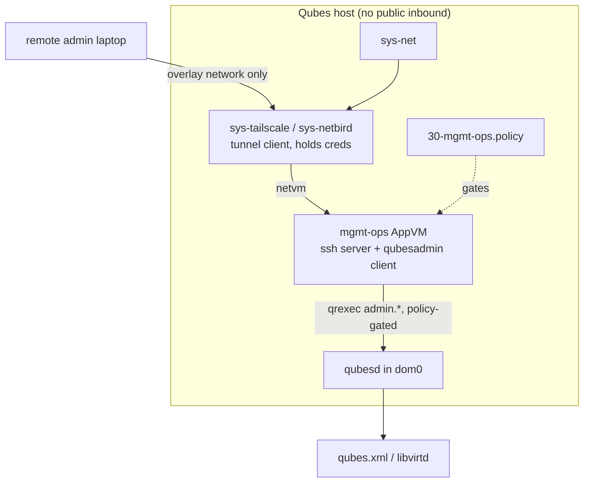

# Worked example: remote Admin API access over netbird/tailscale

Goal: a remote user administers a Qubes host through the Admin API without
anything on the host accepting inbound connections from the public
internet, and without dom0 ever being reachable. This is the
"remote management" use case the Admin API was designed for
([README.md](README.md#what-it-is)), wired up with a WireGuard-based mesh
VPN (tailscale or netbird — pick one; the host-side design is identical).

## Design and why

Both tools are userspace WireGuard with an identity/ACL control plane.
Clients dial *out* through the qube's normal uplink and maintain a
persistent tunnel; the remote user then reaches the qube's overlay IP
through that established tunnel. Nothing listens on a public port — which
is exactly the property you want inside Qubes, where `sys-net`/`sys-firewall`
exist to avoid exposing qubes at all.

Two isolation levels:

| Variant | Topology | Tradeoff |
|---|---|---|
| **A (recommended): tunnel qube** | `sys-tailscale`/`sys-netbird` service qube runs the client and acts as netvm for a netless `mgmt-ops` AppVM | tunnel credentials and overlay traffic live in a replaceable service qube; `mgmt-ops` has **no** other network — mirrors the documented `sys-vpn` pattern |
| B (simpler): client in the ops qube | `mgmt-ops` runs the client directly (userspace, no root) and has normal uplink | one fewer qube; creds sit in the same qube as the admin tooling |

The rest of this page assumes variant A; variant B differs only in where
the client binary runs.



The remote user connects to `mgmt-ops` (SSH) and runs `qubesadmin`
tooling *there*; `mgmt-ops` talks to dom0 through policy-scoped qrexec.
dom0 exposes nothing; the tailnet ACL exposes only `mgmt-ops`.

## Step 1 — create the qubes

```console
[user @dom0 ~]$ qvm-create --template fedora-41-minimal --label gray sys-tailscale
[user @dom0 ~]$ qvm-prefs sys-tailscale netvm sys-net
[user @dom0 ~]$ qvm-prefs sys-tailscale provides_network True
[user @dom0 ~]$ qvm-create --template fedora-41-minimal --label black mgmt-ops
[user @dom0 ~]$ qvm-prefs mgmt-ops netvm sys-tailscale
```

Install the client in the service qube (from its template, then rebuild
the template — never install into the qube itself):

```console
[user @fedora-41-minimal ~]$ sudo dnf install tailscale   # or netbird
[user @dom0 ~]$ qvm-shutdown --wait fedora-41-minimal && qvm-start sys-tailscale
```

Join the network inside `sys-tailscale` (`tailscale up --advertise-tags=tag:qubes-mgmt`
or `netbird up --setup-key …`), enable `qubes-updates-proxy`-style
forwarding as needed, and confirm `mgmt-ops` resolves overlay names
(MagicDNS / netbird DNS). Harden on the *control plane* side: tailnet ACLs
(netbird: access-control groups) that allow only the admin's devices to
reach `mgmt-ops`'s SSH port — the host side enforces *which qube* may
talk to dom0, the tailnet enforces *which human* may reach the qube.

## Step 2 — SSH into the ops qube, never dom0

The ingress endpoint is a domU. Its compromise is bounded by its policy
lines (below); dom0 has no overlay presence at all.

In `mgmt-ops`, install the server (from the template), then place the
admin's public key by hand or by `qvm-copy` from your vault qube — not by
pasting it through a dom0 terminal. Harden `/etc/ssh/sshd_config`
(template-side):

```
PasswordAuthentication no
KbdInteractiveAuthentication no
AllowUsers admin
PermitRootLogin no
```

Persistent qube-level tweaks go in `/rw/config/rc.local` (runs at every
qube start). Note what this SSH server is *for*: it lands the user in a
qube whose only powers are the `admin.*` calls policy allows. It is not a
general shell into the system.

## Step 3 — the policy: least privilege, `target=dom0` everywhere

Create `/etc/qubes/policy.d/30-mgmt-ops.policy` in dom0:

```text
# -- read-only: broad, but still scoped to the ops qube ----------------
admin.vm.List          * mgmt-ops @anyvm        allow target=dom0
admin.vm.CurrentState  * mgmt-ops @anyvm        allow target=dom0
admin.property.Get     * mgmt-ops @anyvm        allow target=dom0
admin.vm.property.Get  * mgmt-ops @anyvm        allow target=dom0
admin.vm.feature.Get   * mgmt-ops @anyvm        allow target=dom0
admin.vm.tag.List      * mgmt-ops @anyvm        allow target=dom0
admin.Events           * mgmt-ops @anyvm        allow target=dom0

# -- write verbs: only on qubes explicitly handed over -----------------
admin.vm.Start         * mgmt-ops @tag:managed-by-mgmt-ops allow target=dom0
admin.vm.Shutdown      * mgmt-ops @tag:managed-by-mgmt-ops allow target=dom0
admin.vm.property.Set  * mgmt-ops @tag:managed-by-mgmt-ops allow target=dom0

# -- dangerous: interactive confirmation in dom0 ------------------------
admin.vm.Remove        * mgmt-ops @tag:managed-by-mgmt-ops ask target=dom0
policy.Replace         * mgmt-ops dom0          ask target=dom0

# -- explicitdeny reminder: everything else is denied implicitly,
#    but say it anyway so an auditor reads intent:
admin.vm.Create.AppVM  * mgmt-ops @anyvm        deny
admin.vm.Kill          * mgmt-ops @anyvm        deny
```

Note the three mechanisms stacked:

1. **`target=dom0` on every line** — without it, a destination like
   `@anyvm` routes the call to the target qube, starting stopped qubes as
   a side effect, and then fails anyway ([README.md](README.md#the-targetdom0-rule)).
2. **`@tag:managed-by-mgmt-ops`** as destination selector — write verbs
   apply only to qubes tagged `managed-by-mgmt-ops`
   ([automation.md](automation.md#tags-designed-for-delegation)). Hand a
   qube over by tagging it in dom0:

   ```console
   [user @dom0 ~]$ qvm-tags work add managed-by-mgmt-ops
   ```

3. **`ask` for the verbs you'd want a human to see** — the confirmation
   dialog appears at the host, so someone physically present gates
   deletions and policy edits even for the remote operator.

The ops qube administers itself only where needed: it is *not* in
`@tag:managed-by-mgmt-ops`, so it cannot restart itself (a stuck remote
session then requires the host owner, which is the correct failure
direction).

## Step 4 — use it

From the remote laptop:

```console
[laptop ~]$ ssh admin@mgmt-ops.<tailnet>          # overlay IP / MagicDNS
[mgmt-ops ~]$ python3 -c '
import qubesadmin
app = qubesadmin.Qubes()          # QubesRemote: goes through policy
for vm in app.domains:
    print(vm.name, vm.get_power_state())'
[mgmt-ops ~]$ python3 -c '
import qubesadmin
app = qubesadmin.Qubes()
app.domains["work"].start()       # allowed: work is tagged
app.domains["random"].start()     # PermissionDenied: not tagged'
```

That second command failing is the system working: `qubesadmin.exc.PermissionDenied`
= the policy engine said no, and no qvm-side code changes it.

### What the remote user gets for monitoring free

`admin.Events` is allowed read-only, so a watcher in `mgmt-ops` can stream
system events over SSH (log to a file, trigger alerts):

```python
import asyncio, qubesadmin
from qubesadmin.events import EventsDispatcher

async def main():
    app = qubesadmin.Qubes()
    d = EventsDispatcher(app)
    d.add_handler('domain-add', lambda s, e, **kw: print('created:', kw))
    await d.listen_for_events(vm=None)

asyncio.run(main())
```

## Best practices recap

- **dom0 is never an endpoint.** No SSH, no overlay IP, no forwarded
  ports; `qubes-connect-tcp`/port-forwarding recipes stay unused here.
- **Ingress lives in a domU with a minimal template**; a compromised
  `mgmt-ops` yields only the policy-granted API surface.
- **Two independent gates**: tailnet ACL decides *which device/user*;
  qrexec policy decides *which calls and which qubes*. Neither alone is
  sufficient.
- **Every `admin.*` line carries `target=dom0`**; write verbs scoped by
  `@tag:managed-by-*`; `ask` (host-side human) for destructive and
  policy-editing verbs; everything else implicit-deny.
- **Credentials hygiene**: short key expiry in the tailnet control plane
  (tailscale key expiry / netbird enrollment), rotate SSH keys per admin,
  keep the tunnel client qube's template updated via the normal update
  flow (`qubes-vm-update`).
- **Auditability**: SSH sessions and every allowed qrexec call are
  logged inside the host (sshd logs in `mgmt-ops`; qrexec in dom0) —
  check both, since the API surface is deliberately narrow enough that
  the log is readable.
- **Rollback**: treat `30-mgmt-ops.policy` as code — keep it in the same
  git repo as the automation it enables, and remember `policy.Replace`
  (the API's own editor) validates before saving, so a bad push cannot
  brick the policy engine.

## Variations

- **Multiple hosts**: replicate the two qubes + one policy file per host;
  point the remote user's tooling at each. A fleet manager qube can fan
  out with `admin.Events`-driven reconciliation per host.
- **No SSH**: serve a narrow HTTP API from `mgmt-ops` bound to the
  overlay IP only — the overlay replaces TLS-in-SSH; the policy surface is
  unchanged. Only worth it for programmatic callers; SSH is the boring
  default.
- **Paranoia upgrade**: run the ops session in a disposable based on a
  dedicated `mgmt-dvm` template (`management_dispvm` pattern,
  [automation.md](automation.md#where-automation-can-run)) so the ingress
  qube leaves nothing persistent.
