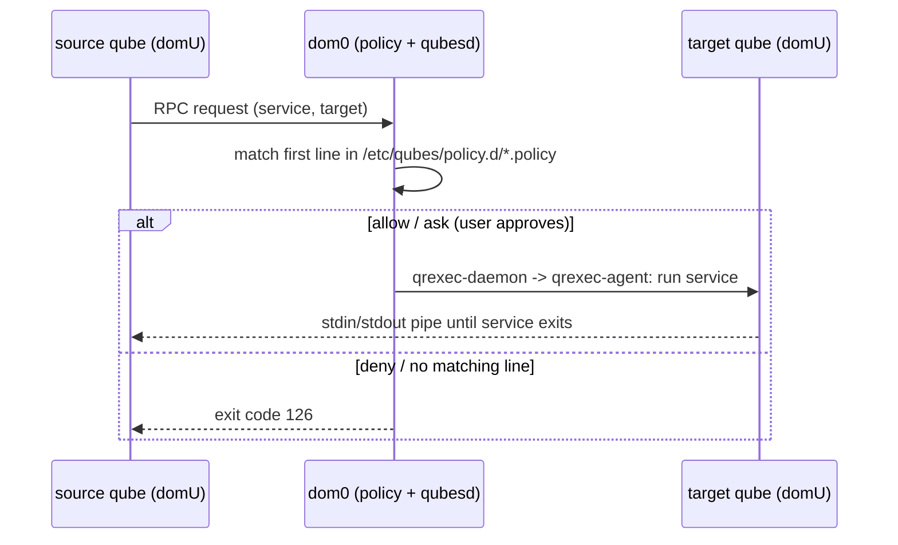

# qrexec — the RPC layer under everything

Every cross-qube interaction in Qubes — file copies, `qvm-run`, inter-VM
clipboard, device handling, even the domU `qvm-*` tools talking to dom0 —
is a **qrexec RPC call**: a named service invoked by a source qube on a
target qube, gated by dom0's policy engine before anything runs. dom0 is
always the decision point and never runs untrusted code itself.

```
AppVM "work"                dom0                    target qube
    │                        │                          │
    │ qrexec-client-vm       │                          │
    │  "target" service ───► │ policy check             │
    │                        │  allow ────────────────► │ qrexec-agent
    │ ◄──────────────────── stdin/stdout pipe ────────── │ runs service
```



## The two client tools

### `qrexec-client-vm` — runs in a domU

The building block used by `qvm-copy`, `qvm-open-in-vm`, etc. Synopsis and
behaviour in [domu-tools.md](domu-tools.md#the-raw-rpc-client).
Key points: target may be `''`/`$default` (policy decides), `$dispvm`, or
`$dispvm:template`; arguments ride after a `+` in the service name;
exit code `126` means the policy said no.

### `qrexec-client` — runs in dom0

```console
[user @dom0 ~]$ qrexec-client -e -d someVM user:'touch hello-world.txt'
[user @dom0 ~]$ qrexec-client -d someVM user:bash
```

- `-d <domX>` target domain, `-l <local_program>` pipe a local program,
  `-e` exit after relaying the exec status, `user:` prefix chooses the
  target user.
- This is what `qvm-run` is "heavily based on"; the docs' advice is that
  `qvm-run` is usually more convenient because it also starts the domain
  and its GUI daemon. Reach for `qrexec-client` only when scripting dom0
  without wanting `qvm-run`'s autostart behaviour.
- Internals-only daemons (`qrexec-daemon` in dom0, `qrexec-agent` in every
  qube, `qrexec-policy`) exist but are explicitly "not designed to be used
  by users directly".

## Policy files

- Location: `/etc/qubes/policy.d/*.policy` in dom0 (volatile overrides in
  `/run/qubes/policy.d/`). Lower-numbered file wins on conflict;
  conventions put user edits in `30-user.policy`. (Older docs and pages
  still reference the pre-4.1 per-service path `/etc/qubes-rpc/policy/<service>`
  — stale, treat `policy.d/` as canonical.)
- One line per rule, first match wins, **no match = deny**:

  ```
  service-name|* [+argument|*] source destination action [options]
  ```

- Actions: `allow`, `deny`, `ask`. Keywords for source/destination:
  `@anyvm`, `@default`, `@dispvm`, `@tag:<tag>`, `@type:<type>`, `dom0`,
  `*`. `$`-prefixed keywords are deprecated — use `@`.
- Options: `target=<vm>` (redirect the call), `default_target=<vm>` (for
  `ask` dialogs).

Worked example (from the rpc-policy tutorial) for `qubes.FileCopy`:

```
@tag:work   @default    ask
@tag:work   @tag:work   allow
@tag:work   @anyvm      deny
@anyvm      @tag:work   deny
@anyvm      @anyvm      ask
```

A qube tagged `work` copying to another `work` qube sails through; to
anyone else it's denied before any dialog appears.

## The admin API (`admin.*`) — how domUs manage the system

`qubesd` (in dom0) serves the `admin.*` service family — create/remove
qubes, set properties, edit firewall, run backups, even edit policy files
(`policy.Replace`). This is the *only* supported way to manage the system
without typing in dom0.

- The dom0 `qvm-*` commands are frontends to these same calls when run
  locally; from another qube, a client like `qvm-*` (via
  `admin.vm.property.Set` and friends) needs a policy line such as:

  ```
  admin.vm.property.Set * work-ops work allow target=dom0
  ```

  i.e. an **explicit `target=dom0` allow** — by default nothing may call
  admin API. In the default install the only admin qube is dom0; granting
  a domU admin rights is done exactly this way, per-service, per-source.
- Notable calls: `admin.vm.List`, `admin.vm.Create.<class>`,
  `admin.vm.CreateDisposable`, `admin.vm.property.Set`,
  `admin.property.Set`, `admin.pool.*`, `admin.backup.Execute`,
  `admin.Events`, `admin.vm.Stats`, plus `policy.*` for editing policy
  itself.
- There is deliberately **no admin-API equivalent of `qvm-run`**; arbitrary
  command execution is what `qubes.VMShell` (a regular service, policy
  gated like any other) is for.

Practical stance for this repo: our helper scripts run in dom0 and use the
dom0 `qvm-*` frontends directly. The admin API matters only if we ever want
an AppVM to be able to manage qubes (e.g. a custom domU dashboard) — and
then only via a narrow, per-service policy entry.
