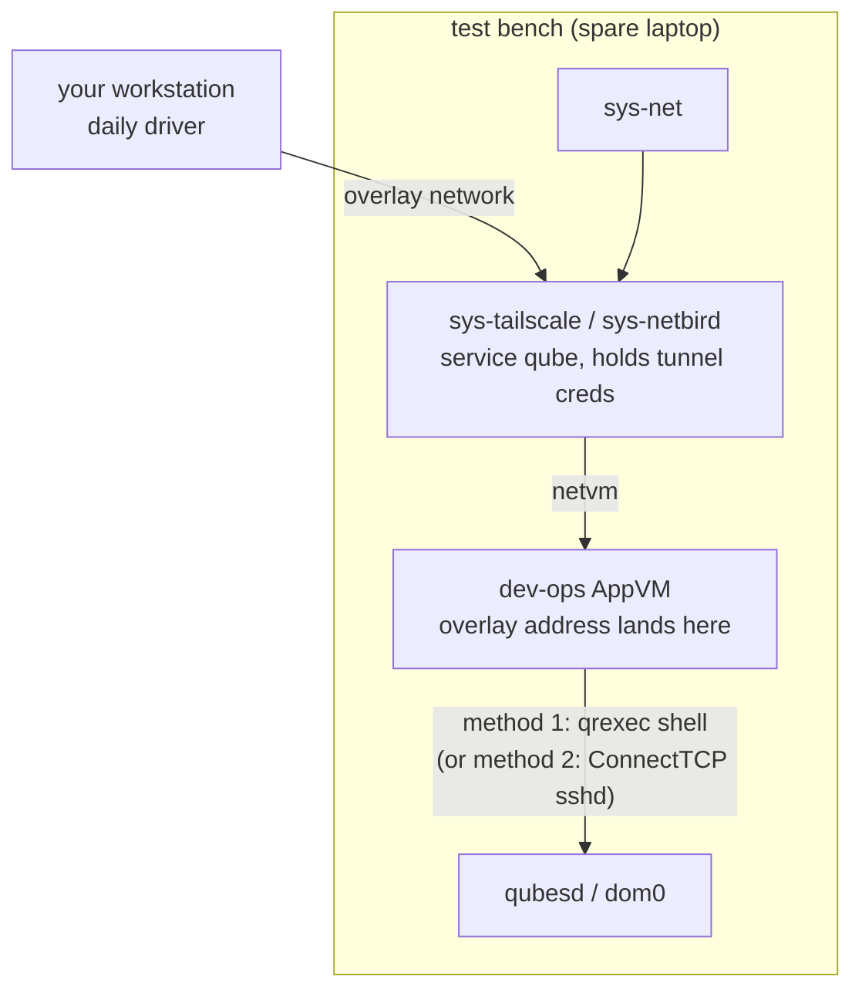

# Method 4 — remote development access (no new dom0 exposure)

"Development from elsewhere" — your workstation drives the test bench over
a mesh VPN — **without** adding any listener to dom0. This composes with
methods 1–3: the overlay client lives in an AppVM (or service qube) on the
host, and the last hop to dom0 is whichever of the earlier methods you
chose, ideally method 1 (qrexec, nothing IP-listening in dom0).

## Topology



The bench's tailnet/netbird ACL admits only your workstation's device
identity; the host-side qrexec policy admits only `dev-ops`. Two gates,
same as the [admin-API remote pattern](../qubes-admin-api/remote-access-example.md)
— that page's qube/policy/ACL discipline applies verbatim, so only the
deltas are repeated here.

## Setup deltas

1. Create the tunnel service qube and `dev-ops` AppVM exactly as in
   [remote-access-example.md](../qubes-admin-api/remote-access-example.md)
   ("Step 1 — create the qubes": netless ops qube behind the tunnel
   qube; client installed template-side).
2. Enroll in tailscale/netbird with **tag-scoped identity**
   (`tag:qubes-bench`), and write the ACL so only your dev device can
   reach `dev-ops`'s SSH port. Short key expiry on.
3. In `dev-ops`, `ssh` targets dom0 via method 1 or 2:

   ```console
   [user @dev-ops ~]$ qvm-connect-tcp 2222:@default:22   # method 2
   [user @dev-ops ~]$ ssh -p 2222 user@localhost
   ```

   …or skip TCP entirely with the qrexec shell (method 1), which is why it
   pairs best with remote access: dom0 still has zero listeners.

4. From the workstation, everything is ordinary SSH through the overlay:

   ```console
   [laptop ~]$ ssh dev-ops.<tailnet>
   ```

## Why this is the right remote shape

- The overlay never terminates in dom0. Credentials live in a replaceable
  service qube; a tunnel-compromise scenario yields `dev-ops` + its policy
  lines, not dom0.
- Revoke = one ACL edit in the tailnet/netbird admin panel, plus removing
  the local policy file. No dom0-side networking was ever touched.
- If the bench must be unreachable, `qvm-shutdown sys-tailscale` severs
  the path without logging into anything.

## Development-loop placement

Keep the *editor and git remotes* on the workstation; keep the *executor*
on the bench:

```console
[laptop ~]$ ssh dev-ops.<tailnet> 'cd ~/src/qubes-core-admin && python -m qubes.tests.run -t integration'
[laptop ~]$ rsync -av --exclude=.git my-change/ dev-ops.<tailnet>:~/src/patch/   # lands in dev-ops
```

…then inside `dev-ops` push the patch into dom0 over qrexec stdio
(method 1) or scp-over-ConnectTCP (method 2). Only the sacrificial dom0
sees the test-build churn.

## Revert

Shutdown/remove the two qubes. dom0 untouched — that's the point of the
composition.
